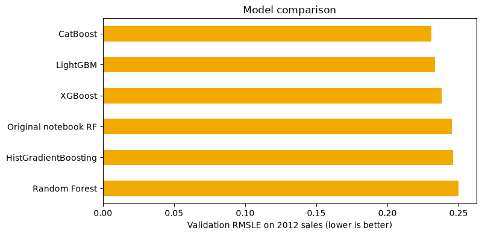
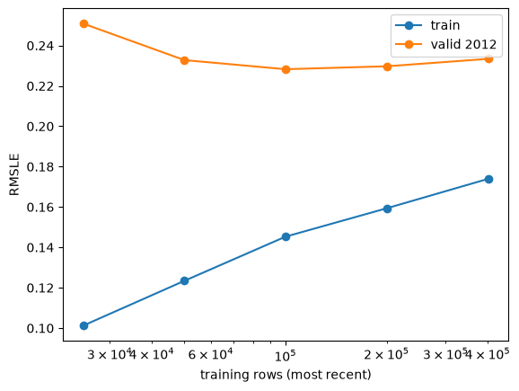
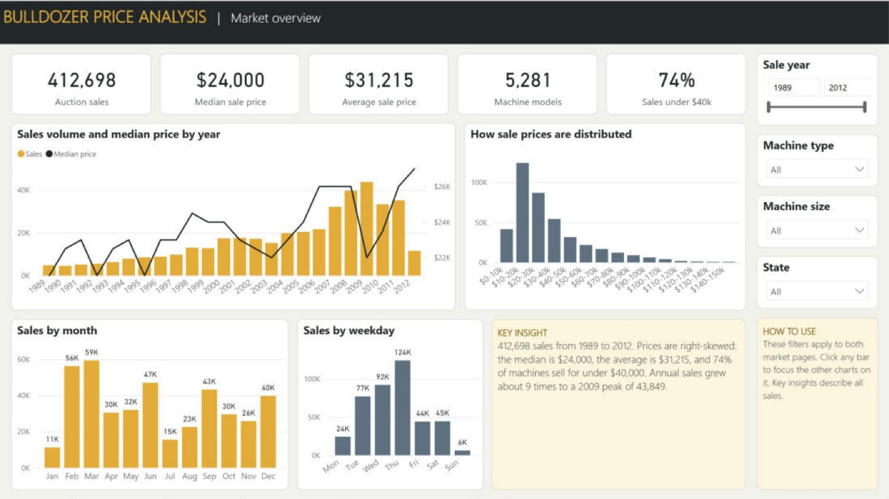
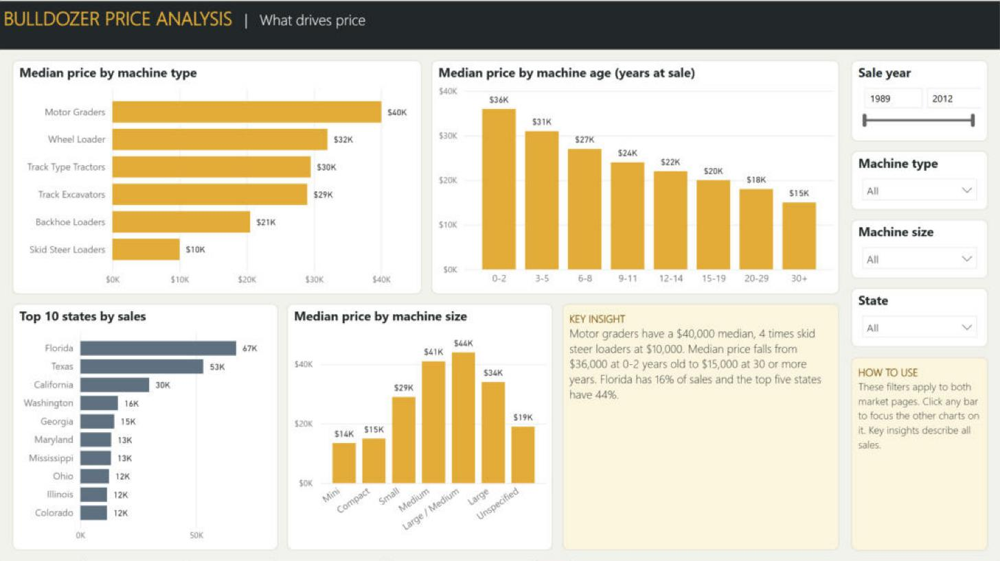
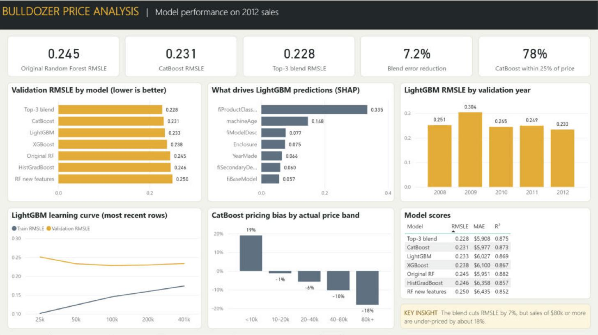

# Bulldozer Sale Price Prediction

An end-to-end machine learning project that predicts the auction sale price of used bulldozers from their characteristics and sale history, followed by an exploratory analysis that answers 10 business questions and a PowerPoint deck presenting the findings.

- **Problem type:** supervised regression on time series data
- **Data:** [Kaggle: Blue Book for Bulldozers](https://www.kaggle.com/c/bluebook-for-bulldozers/data)
- **Models:** scikit-learn `RandomForestRegressor`, then a comparison with HistGradientBoosting, XGBoost, LightGBM and CatBoost
- **Evaluation metric:** RMSLE (root mean squared log error), as set by the Kaggle competition
- **Random Forest result:** validation RMSLE **0.245**, R² **0.88**, mean absolute error **$5,951** on 2012 sales
- **Best result:** CatBoost reaches RMSLE **0.231**, and a CatBoost, LightGBM and XGBoost blend reaches **0.228**



---

## Contents

1. [Project structure](#1-project-structure)
2. [Workflow at a glance](#2-workflow-at-a-glance)
3. [Step 1: Problem definition](#3-step-1-problem-definition)
4. [Step 2: Data](#4-step-2-data)
5. [Step 3: Evaluation](#5-step-3-evaluation)
6. [Step 4: Features and preprocessing](#6-step-4-features-and-preprocessing)
7. [Step 5: Modelling](#7-step-5-modelling)
8. [Step 6: Results and fit diagnosis](#8-step-6-results-and-fit-diagnosis)
9. [Exploratory analysis: 10 questions answered](#9-exploratory-analysis-10-questions-answered)
10. [Presentation deck](#10-presentation-deck)
11. [How to reproduce](#11-how-to-reproduce)
12. [Known issues and limitations](#12-known-issues-and-limitations)
13. [Next steps](#13-next-steps)

---

## 1. Project structure

```
Project2_bulldozer-price-prediction/
├── data/
│   ├── raw/bluebook-for-bulldozers/             # Original Kaggle files
│   │   ├── TrainAndValid.csv                    # 412,698 sales, 1989 to Apr 2012 (not in Git, download from Kaggle)
│   │   ├── Train.csv, Train/, Machine_Appendix.csv  # Other large Kaggle files (not in Git)
│   │   ├── Test.csv, Valid.csv, ValidSolution.csv   # Test and validation files
│   │   └── Data Dictionary.xlsx, *benchmark*.csv    # Column descriptions and Kaggle benchmarks
│   └── processed/
│       ├── train_tmp.csv                        # Preprocessed backup from the notebook (not in Git)
│       ├── analysis_results.json                # Numbers behind the 10 business questions
│       ├── encoding_results.json, test_results.json  # Test-set encoding checks
│       ├── model_comparison_results.json        # Scores for every model
│       ├── test_predictions*.csv                # Predicted prices for the test set
│       └── powerbi/                             # Tables read by the Power BI dashboard
├── images/                                      # Notebook charts and dashboard screenshots
├── notebooks/
│   ├── 01_Bulldozer_Price_Regression_Annotated.ipynb  # Main notebook with step-by-step comments
│   └── 02_Bulldozer_Model_Comparison.ipynb      # Random Forest against gradient boosting
├── powerbi/
│   └── Bulldozer_Price_Dashboard.pbix           # 4-page interactive dashboard
├── presentation/
│   ├── bulldozer_price_analysis.pptx            # 17-slide findings deck
│   ├── bulldozer_model_comparison.pptx          # 14-slide model comparison deck
│   ├── bulldozer_interview_qa.pptx              # 39-slide interview preparation deck
│   └── scripts/                                 # Analysis and deck-building scripts
├── videos/                                      # Reserved for walkthroughs (none recorded yet)
├── end-end-bulldozer-price-regression.ipynb     # Original end-to-end notebook
├── requirements.txt
└── README.md
```

---

## 2. Workflow at a glance

The project follows a 6-step machine learning framework:

```
 ┌────────────────┐   ┌───────────┐   ┌──────────────┐   ┌─────────────────────┐   ┌──────────────┐   ┌──────────────────┐
 │ 1. Problem     │──▶│ 2. Data   │──▶│ 3. Evaluation│──▶│ 4. Features &       │──▶│ 5. Modelling │──▶│ 6. Results &     │
 │    definition  │   │  load,    │   │  pick RMSLE  │   │    preprocessing    │   │  baseline,   │   │    communication │
 │                │   │  explore  │   │              │   │  dates, missing     │   │  tune, train │   │  analysis + deck │
 └────────────────┘   └───────────┘   └──────────────┘   │  values, categories │   └──────────────┘   └──────────────────┘
                                                         └─────────────────────┘
```

| Stage | What was done | Where |
|---|---|---|
| Load | Read `TrainAndValid.csv` with `saledate` parsed as a date, sorted by date | Notebook cells 5–20 |
| Feature engineering | Split `saledate` into year, month, day, day of week, day of year | Cells 24–30 |
| Preprocessing | Fill missing values, add missing-value flags, convert text to category codes | Cells 36–67 |
| Split | Train = sales before 2012, validation = 2012 sales | Cells 72–77 |
| Baseline | Random Forest on a 10,000-row sample | Cells 81–84 |
| Tuning | `RandomizedSearchCV` over Random Forest settings | Cells 85–87 |
| Final model | Random Forest with the best settings, trained on all training rows | Cells 88–91 |
| Test predictions | Preprocess `Test.csv`, align columns, predict 12,457 sales | Cells 92–113 |
| Analysis | 10 business questions answered from the data | `presentation/scripts/analysis.py` |
| Model comparison | Random Forest against four gradient boosting models | `notebooks/02_Bulldozer_Model_Comparison.ipynb` |
| Communication | 17-slide PowerPoint | `presentation/bulldozer_price_analysis.pptx` |

---

## 3. Step 1: Problem definition

> How well can we predict the future sale price of a bulldozer, given its characteristics and previous examples of how much similar bulldozers have sold for?

- **Inputs:** machine characteristics (year made, model, product size, enclosure, hydraulics, and so on) plus where and when it was sold.
- **Output:** sale price in US dollars.
- Because the target is a continuous number, this is a **regression** problem. Because every row has a sale date and we want to predict *future* sales, it is also a **time series** problem. That shapes how the data is split (Step 5).

---

## 4. Step 2: Data

| File | Rows | Period | Purpose |
|---|---|---|---|
| `TrainAndValid.csv` | 412,698 | Jan 1989 to Apr 2012 | Training and validation (has `SalePrice`) |
| `Test.csv` | 12,457 | May to Nov 2012 | Final predictions (no `SalePrice`) |

Key facts about the training data:

- **53 columns**, including the target `SalePrice`
- **5,281** distinct machine models (`ModelID`) across **53** US states (including "Unspecified")
- Most columns are **text** (for example `ProductSize`, `Enclosure`, `state`) and need converting to numbers
- Many columns are **mostly empty**: 40 of 53 have gaps, and 35 are more than 50% missing
- `YearMade = 1000` is used as a placeholder for unknown build year in about 9.5% of rows

---

## 5. Step 3: Evaluation

**Main metric: RMSLE (root mean squared log error)**

$$\text{RMSLE} = \sqrt{\frac{1}{n}\sum_{i=1}^{n}\left(\log(1+\hat{y}_i) - \log(1+y_i)\right)^2}$$

Why RMSLE fits this problem:
- It measures **relative** error. Being $5,000 off on a $10,000 skid steer is penalised much more than being $5,000 off on a $100,000 grader.
- Prices are **right-skewed** (median $24,000, mean $31,215). A log-based metric stops the few very expensive machines from dominating the score.
- It is the official Kaggle metric, so results can be compared with the leaderboard. **Lower is better.**

**Supporting metrics** (from the notebook's `show_scores()` function):
- **MAE (mean absolute error):** average error in dollars, easy to explain to non-technical audiences
- **R² (coefficient of determination):** share of price variation the model explains

Every metric is reported on both the **training** and **validation** sets, so the two can be compared to check for overfitting and underfitting (see [Step 6](#8-step-6-results-and-fit-diagnosis)).

---

## 6. Step 4: Features and preprocessing

All preprocessing is done on a copy of the data (`df_tmp`) so the raw data stays untouched.

### 6.1 Sort by date
Rows are sorted by `saledate`. For time series data this keeps the order of events and makes the time-based split clean.

### 6.2 Date feature engineering
A raw timestamp can't go into a Random Forest directly, so `saledate` is split into five numeric features and then dropped:

| New feature | Example |
|---|---|
| `saleYear` | 2009 |
| `saleMonth` | 3 |
| `saleDay` | 17 |
| `saleDayOfWeek` | 3 (Thursday) |
| `saleDayOfYear` | 76 |

`saleYear` later turns out to be the 3rd most important feature.

### 6.3 Missing numeric values
For each numeric column with gaps (for example `auctioneerID`, `MachineHoursCurrentMeter`):
1. Add a `<column>_is_missing` True/False flag column
2. Fill the gaps with the column's **median** (not the mean, because the median is robust to skew and outliers)

### 6.4 Text (categorical) columns
For each non-numeric column:
1. Add a `<column>_is_missing` flag
2. Convert the text to a pandas category, then to its integer code **+ 1**, so missing values (code −1) become **0**

The `_is_missing` flags matter: the fact that a value is missing can itself carry information. `ProductSize_is_missing` ends up in the model's top 10 features.

After preprocessing there are **no missing values**, every column is numeric, and the data has 103 columns: 57 features (the original columns plus the 5 date features, minus `saledate`) and 46 `_is_missing` flags (2 numeric, 44 text).

A backup of the intermediate data is saved to `data/processed/train_tmp.csv`.

---

## 7. Step 5: Modelling

### 7.1 Model choice
**`RandomForestRegressor`** from scikit-learn:
- Strong default choice for tabular data with mixed feature types
- Needs no feature scaling
- Handles non-linear effects and interactions between features (for example "age matters more for some machine types")
- Gives feature importances that help explain the model

### 7.2 Train / validation split
Because the goal is to predict **future** prices, the split is by **time**, not random:

| Set | Rule | Rows |
|---|---|---|
| Training | `saleYear != 2012` | 401,125 |
| Validation | `saleYear == 2012` | 11,573 |

A random split would leak future information into training and give an overly optimistic score.

### 7.3 Experiments

| # | Experiment | Key settings | Valid RMSLE |
|---|---|---|---|
| 0 | Baseline: always predict the training median | – | 0.744 |
| 1 | Quick Random Forest (fast experiments) | `max_samples=10000` | 0.294 |
| 2 | `RandomizedSearchCV` best model | `n_estimators=60, max_depth=10, min_samples_leaf=5, max_features=None, max_samples=10000` | 0.316 |
| 3 | **Final model (`ideal_model`)** | `n_estimators=40, min_samples_leaf=1, min_samples_split=14, max_features=0.5, max_samples=None` | **0.245** |

The final settings come from a longer (100-iteration) randomized search, then the model was trained on **all** 401,125 training rows instead of a 10,000-row sample.

---

## 8. Step 6: Results and fit diagnosis

### 8.1 Final model scores

| Metric | Training | Validation (2012) |
|---|---|---|
| MAE | $2,954 | **$5,951** |
| RMSLE | 0.145 | **0.245** |
| R² | 0.959 | **0.882** |

- **67% lower error** than the median-price baseline (0.744 → 0.245)
- Close to the top of the Kaggle leaderboard (about 0.23)

### 8.2 Overfitting or underfitting?

| Pattern | What it looks like | Seen here? |
|---|---|---|
| **Underfitting** | Train and valid errors both high and close together | The depth-limited tuned model (#2): 0.292 train vs 0.316 valid, close but high |
| **Overfitting** | Train error much lower than valid error | The final model: 0.145 vs 0.245, so valid error is about 1.7× train error |
| **Good fit** | Low valid error and a small gap | The final model is close, with mild overfitting |

**Conclusion:** the final model is **not underfitting** and is **mildly overfitting**. This is acceptable, because:
- Its validation score is close to the leaderboard top, which a badly overfit model would not achieve
- Part of the gap comes from validating on a *future* year with different market conditions, not from memorisation
- Random Forests always score very well on their own training rows, so training error alone overstates the problem

**How to confirm:**
- **Learning curve:** train on more and more rows and plot train vs valid RMSLE
- **Validation curve:** vary one setting (for example `min_samples_leaf`) and find where valid error is lowest
- **Time-based cross-validation** (`TimeSeriesSplit`): check the score is stable across several years

### 8.3 What the model relies on (top 10 feature importances)

| Rank | Feature | Importance |
|---|---|---|
| 1 | `YearMade` | 20.8% |
| 2 | `ProductSize` | 15.3% |
| 3 | `saleYear` | 7.4% |
| 4 | `fiSecondaryDesc` | 6.2% |
| 5 | `Enclosure` | 6.2% |
| 6 | `fiProductClassDesc` | 4.7% |
| 7 | `fiBaseModel` | 4.7% |
| 8 | `fiModelDesc` | 4.2% |
| 9 | `ModelID` | 4.1% |
| 10 | `ProductSize_is_missing` | 3.5% |

**Age, size and the exact model** drive price. The time of sale and the missing-value flags also add real signal.

### 8.4 Model comparison

`notebooks/02_Bulldozer_Model_Comparison.ipynb` scores each model on the same 2012 validation sales.

| Model | RMSLE | MAE | R² |
|---|---|---|---|
| Original notebook Random Forest | 0.245 | $5,951 | 0.882 |
| Random Forest (new features) | 0.250 | $6,435 | 0.852 |
| HistGradientBoosting | 0.246 | $6,358 | 0.857 |
| XGBoost | 0.238 | $6,100 | 0.867 |
| LightGBM | 0.233 | $6,027 | 0.869 |
| **CatBoost (best single model)** | **0.231** | **$5,977** | **0.873** |
| **Blend of CatBoost, LightGBM and XGBoost** | **0.228** | **$5,908** | **0.875** |

- CatBoost lowers RMSLE by 6% against the original Random Forest, but its MAE and R² are slightly worse. The blend has the lowest RMSLE and MAE.
- The original Random Forest's settings were chosen using its 2012 score, so its result is slightly optimistic.
- CatBoost predicts 37% of 2012 sales within ±10% of the true price and 78% within ±25%.
- Sales of $80k or more are under-predicted by about 18% on average, and sales under $10k are over-predicted by about 19%.



---

## 9. Exploratory analysis: 10 questions answered

Computed in `presentation/scripts/analysis.py` from `TrainAndValid.csv`.

| # | Question | Answer |
|---|---|---|
| Q1 | How large is the dataset? | 412,698 sales, 53 columns, 5,281 models, 1989–2012 |
| Q2 | What does the price distribution look like? | Right-skewed: median $24,000, mean $31,215; 74% of sales are under $40k; range $4,750 to $142,000 |
| Q3 | How has sales volume changed? | Grew about 9× from 4,806 sales (1989) to a peak of 43,849 (2009) |
| Q4 | Have prices changed over time? | The median stayed in a narrow $21k–$27k band; dipped in 2009 during the recession |
| Q5 | Where do machines sell? | Florida 16% of sales; the top 5 states (FL, TX, CA, WA, GA) 44% |
| Q6 | How much data is missing? | 40 of 53 columns have gaps; 35 are more than 50% empty (several at 93.7%) |
| Q7 | Which machine types sell for most? | Motor graders ($40k median) sell for 4× skid steer loaders ($10k) |
| Q8 | Does age affect price? | Yes: the median falls from $36k (0–2 years old) to $15k (30+ years) |
| Q9 | Is there seasonality? | Sales peak in Feb–Mar and on Thursdays (30% of sales), but the monthly median price only moves between $23k and $26k |
| Q10 | How accurate is the model, and what drives it? | RMSLE 0.245, R² 0.88, MAE $5,951; top drivers are YearMade, ProductSize, saleYear |

---

## 10. Presentation decks

`presentation/bulldozer_price_analysis.pptx`: 17 slides, built with `pptxgenjs` using native (editable) PowerPoint charts.

| Section | Slides |
|---|---|
| Introduction | Title, executive summary (key stats and the 10 questions) |
| Exploring the data | Q1–Q6 |
| Price drivers | Q7–Q9 |
| Modelling | Q10 accuracy, Q10 feature importance, notebook pipeline |
| Test predictions | Test set results, category encoding risk |
| Conclusion | Takeaways and next steps |

Each question slide shows a chart plus a panel with the question and what the data shows.

Two supporting decks are also included: `bulldozer_model_comparison.pptx` (14 slides) and `bulldozer_interview_qa.pptx` (39 slides).

### Power BI dashboard

[`powerbi/Bulldozer_Price_Dashboard.pbix`](powerbi/Bulldozer_Price_Dashboard.pbix) has 4 interactive pages: Market Overview, Price Drivers, Model Performance, and Predictions and Data Quality. See [`powerbi/README.md`](powerbi/README.md) for details.



<p align="center">
  
  
</p>

---

## 11. How to reproduce

**Requirements:** Python 3.11 and Node.js. Run the commands from the project root unless a step says otherwise.

1. **Install the Python packages:**

   ```bash
   pip install -r requirements.txt
   ```

2. **Download the data.** The largest files are not stored in Git. Download the [Kaggle dataset](https://www.kaggle.com/c/bluebook-for-bulldozers/data) and place its files in `data/raw/bluebook-for-bulldozers/`.

3. **Run the notebooks.** Open `end-end-bulldozer-price-regression.ipynb` or the notebooks in `notebooks/`, then run the cells from top to bottom. Three cells in the regression notebooks stop with an error on purpose, to show why the data needs preprocessing, so run past them. Training on 400k rows takes a few minutes, and CatBoost takes about 17 minutes.

4. **Recompute the analysis.** This writes `data/processed/analysis_results.json` and retrains the final model:

   ```bash
   python presentation/scripts/analysis.py
   ```

5. **Rebuild the decks** (from inside `presentation/`):

   ```bash
   npm install
   ```

   ```bash
   node scripts/build_deck.js
   ```

   ```bash
   node scripts/build_findings_deck.js
   ```

   ```bash
   node scripts/build_qa_deck.js
   ```

---

## 12. Known issues and limitations

- **Test categories are encoded separately from training.** The notebook now predicts all 12,457 test sales (cells 105–113), after renaming the date columns, adding `auctioneerID_is_missing = False` and reordering to `X_train.columns`. But `preprocess_data()` builds category codes from `Test.csv` alone, so the same model name or state gets a different number than in training (18 of 44 text columns, every test row). Re-running the 2012 validation set the same way raises RMSLE from 0.245 to 0.399 and MAE from $5,951 to $10,309. Reusing the training categories restores 0.245 (`presentation/scripts/encoding_impact.py`, corrected predictions in `data/processed/test_predictions_fixed.csv`).
- **Submission column name:** the original notebook's output column is `SalesPrice`; Kaggle expects `SalePrice`. `data/processed/test_predictions_best_model.csv` uses the correct name.
- **Placeholder years:** about 9.5% of rows have `YearMade = 1000`. They are left in the model as-is and excluded from the age analysis.
- **Tuning used the validation set.** The best settings were chosen by their 2012 score, so 0.245 is slightly optimistic. Time-based cross-validation would give a more trustworthy estimate.
- **Mild overfitting** (train 0.145 vs valid 0.245 RMSLE).
- **Category codes** are assigned separately to each dataset. Applying the training categories to the test set is safer than recoding the test set on its own.

---

## 13. Next steps

1. **Give recent sales more weight.** Validation error is lowest when LightGBM trains on only the most recent 100,000 sales.
2. **Tune the boosting models with time-based cross-validation** so the settings don't overfit to 2012.
3. **Reduce the under-pricing of expensive machines**, which are under-predicted by about 18% at $80k and above.
4. **Submit `data/processed/test_predictions_best_model.csv` to Kaggle** to get an independent score.
5. **Record walkthrough videos** of the notebooks and dashboard for `videos/`.
