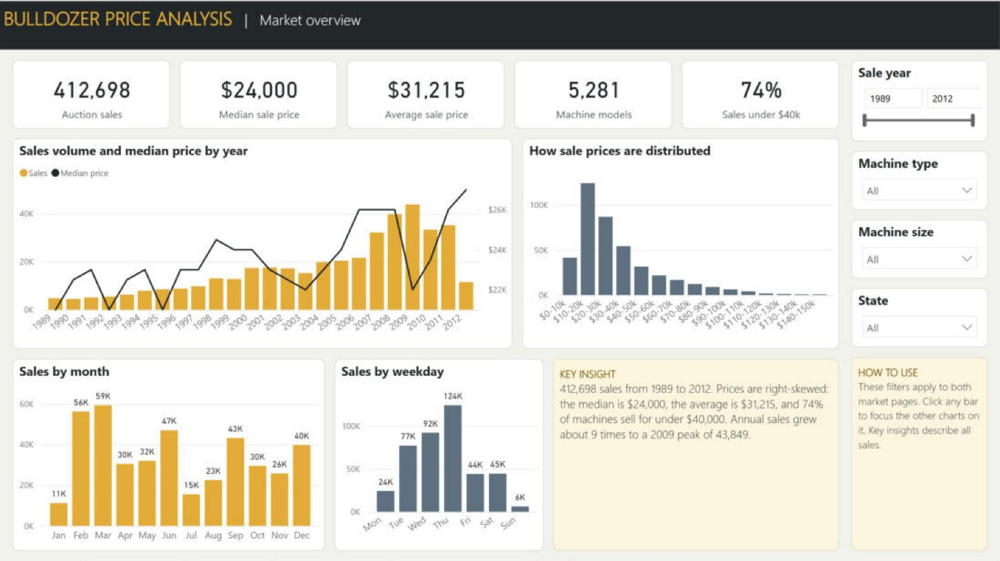

# Power BI dashboard

**Open [`Bulldozer_Price_Dashboard.pbix`](Bulldozer_Price_Dashboard.pbix) in Power BI Desktop.** The data is embedded, so the report works straight away.

## Pages

| Page | What it answers | Main visuals |
|---|---|---|
| **Market Overview** | How big is the market, and how are prices spread? | Sales and price KPIs, yearly trend, price distribution, sales by month and weekday |
| **Price Drivers** | What makes a machine worth more? | Median price by machine type, age and size, top 10 states |
| **Model Performance** | How accurate are the models on 2012 sales? | RMSLE by model, SHAP importance, yearly validation, learning curve, pricing bias |
| **Predictions and Data Quality** | What does the best model predict, and how complete is the data? | CatBoost test predictions, ten emptiest columns |

The sale year, machine type, machine size and state filters are synced across the first two pages. The key insight text boxes describe all sales and do not change with the filters.

## Files

| File or folder | Purpose |
|---|---|
| `Bulldozer_Price_Dashboard.pbix` | The finished dashboard |
| `Bulldozer_Price_Dashboard.pbip` | The same dashboard as a text-based Power BI Project |
| `Bulldozer_Price_Dashboard.SemanticModel/` | 9 tables and 31 DAX measures |
| `Bulldozer_Price_Dashboard.Report/` | The 4 report pages and 52 visuals |
| `prepare_powerbi_data.py` | Creates the dashboard tables in `data/processed/powerbi/` |
| `build_dashboard.py` | Generates the Power BI Project |

## Refreshing the data

The tables are read from `data/processed/powerbi/` through a Power Query parameter called `DataFolder`.

1. Run `python powerbi/prepare_powerbi_data.py` from the project root. This creates `sales.csv`, which is too large to keep in Git. It needs the Kaggle `TrainAndValid.csv` file in `data/raw/bluebook-for-bulldozers/`.
2. If the project has moved, go to **Home → Transform data → Edit parameters** in Power BI Desktop and point `DataFolder` at your `data/processed/powerbi/` folder. Keep the final backslash.
3. Click **Refresh**.
